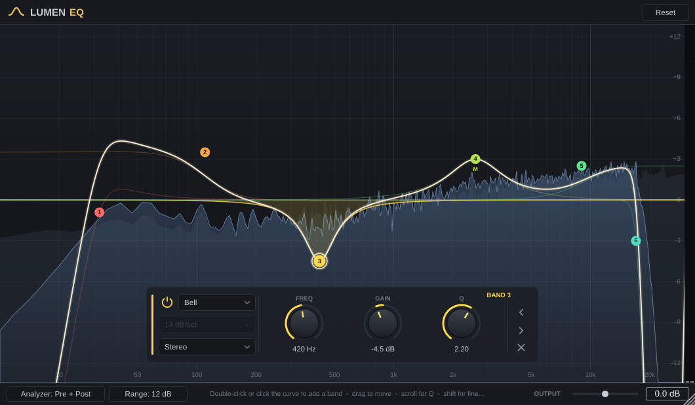

# Lumen EQ

A 16-band parametric EQ plugin (VST3 / AU / Standalone) built with JUCE, with a
workflow and look inspired by FabFilter Pro-Q: a big interactive spectrum
display, draggable colour-coded band nodes and a floating band control panel.



## Features

- **16 bands**, each with 8 shapes: Bell, Low Shelf, Low Cut, High Shelf, High Cut, Notch, Band Pass, Tilt Shelf
- **Cut slopes** from 6 to 96 dB/oct (Butterworth cascades; Q adds resonance)
- **Per-band stereo placement**: Stereo, Left, Right, Mid, Side
- **Real-time spectrum analyzer**: pre/post EQ, 8192-point FFT, 4.5 dB/oct display tilt
- **Smoothed parameters** and click-free band enable/bypass
- Composite and per-band response curves computed from the exact same filter math as the audio engine
- Output gain, stereo peak meter, display range 3/6/12/18/30 dB, resizable window
- Every parameter automatable; state saved with the host session

## Mouse controls

| Action | Result |
| --- | --- |
| Double-click empty space | Add a band at that point (near the edges adds a low/high cut) |
| Click the curve (ghost node) and drag | Add a band and shape it immediately |
| Drag node | Frequency + gain (vertical = Q for cuts / notch / band pass) |
| Shift + drag | Fine adjustment |
| Mouse wheel over node | Q |
| Double-click node | Bypass band |
| Right-click node | Shape, slope, stereo placement, bypass, delete |
| Alt-click node / Delete key | Remove band |

## Building

Requirements: CMake 3.22+, a C++17 compiler (Visual Studio 2022, Xcode, or GCC/Clang).
JUCE 8.0.4 is downloaded automatically (or place a JUCE checkout in `./JUCE`).

```bash
cmake -B build -DCMAKE_BUILD_TYPE=Release
cmake --build build --config Release
```

Plugins are written to `build/LumenEQ_artefacts/Release/` (`VST3/Lumen EQ.vst3`,
`AU/Lumen EQ.component` on macOS, and a standalone app). Copy the `.vst3`
into your plugin folder:

- Windows: `C:\Program Files\Common Files\VST3`
- macOS: `~/Library/Audio/Plug-Ins/VST3` (AU: `~/Library/Audio/Plug-Ins/Components`)
- Linux: `~/.vst3`

Linux build dependencies:

```bash
sudo apt install libasound2-dev libx11-dev libxrandr-dev libxinerama-dev libxcursor-dev \
  libxext-dev libfreetype-dev libfontconfig1-dev libgl1-mesa-dev
```

### Tests

```bash
cmake -B build -DLUMEN_BUILD_TESTS=ON && cmake --build build --target LumenEQTests
./build/LumenEQTests_artefacts/Release/LumenEQTests docs/screenshot.png
```

These render sine tones through the processor and check the measured gain
against the analytic response for every filter shape, then save a UI screenshot.

The included GitHub Actions workflow builds Windows, macOS (universal) and Linux
binaries on every push and attaches them as downloadable artifacts.

## Code layout

| File | Purpose |
| --- | --- |
| `Source/EQMath.h` | Filter design (RBJ biquads, Butterworth cascades) + magnitude response |
| `Source/PluginProcessor.*` | Parameters, smoothing, L/R + M/S band processing, analyzer feed |
| `Source/Analyzer.h` | Lock-free audio-to-UI FIFO and FFT spectrum |
| `Source/EQDisplay.*` | Interactive graph: grid, analyzer, curves, nodes, mouse handling |
| `Source/BandPanel.*` | Floating per-band controls |
| `Source/PluginEditor.*` | Window layout, top/bottom bars, output meter |
| `Source/LookAndFeel.*`, `Source/Theme.h` | Visual styling |

"FabFilter" and "Pro-Q" are trademarks of FabFilter. This is an independent project and is not affiliated with them.
